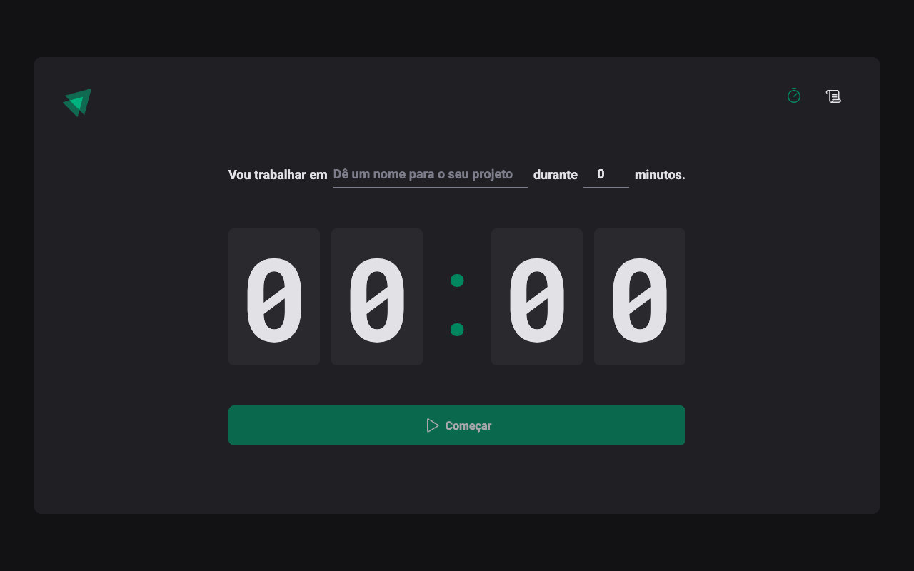

# ⏱️ Ignite Timer

Aplicação de **Pomodoro/timer de tarefas**: você informa em que vai trabalhar e por quantos minutos, inicia o ciclo e acompanha a contagem regressiva. Cada ciclo fica registrado em um histórico. Projeto do módulo de React da trilha **Ignite (Rocketseat)**.



## Funcionalidades

- Formulário validado (nome do projeto + duração em minutos) com `react-hook-form` e `zod`
- Contagem regressiva em tempo real, refletida também no título da aba
- Interrupção de um ciclo em andamento
- Página de histórico com status de cada ciclo (em andamento, concluído, interrompido)
- Rotas com `react-router-dom`

## Tecnologias

React 18 · TypeScript · Vite · styled-components · react-hook-form · zod · date-fns · Phosphor Icons

## Como rodar

```bash
npm install
npm run dev     # http://localhost:5173
```

Outros scripts: `npm run build`, `npm run preview` e `npm run lint`.

## Autor

Feito por [Amós Magalhães](https://github.com/amslimaa).
